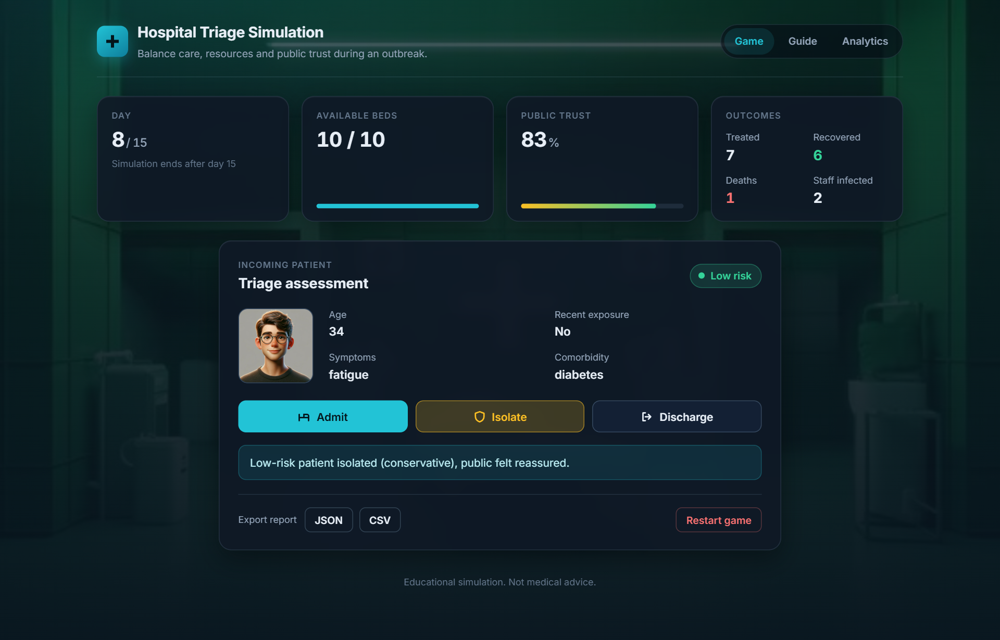
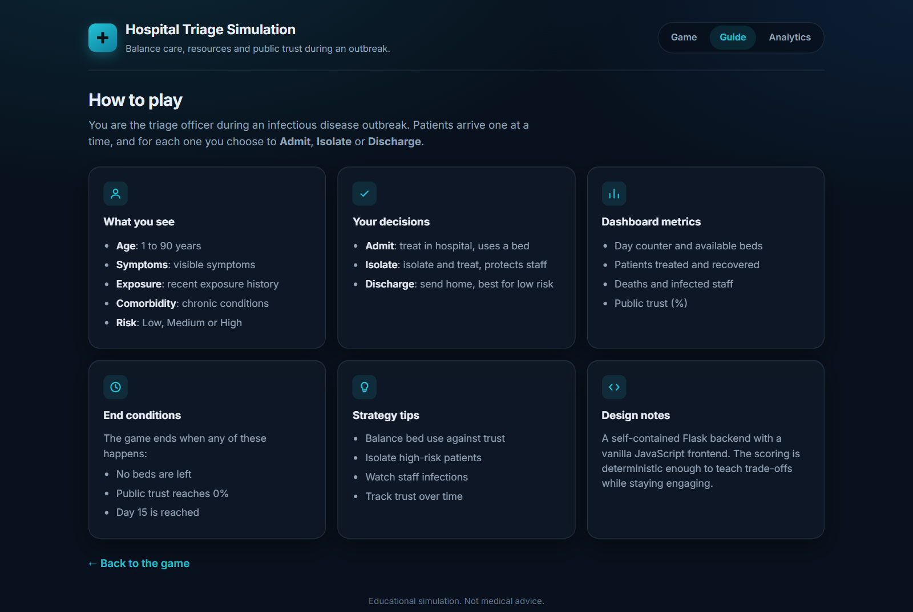
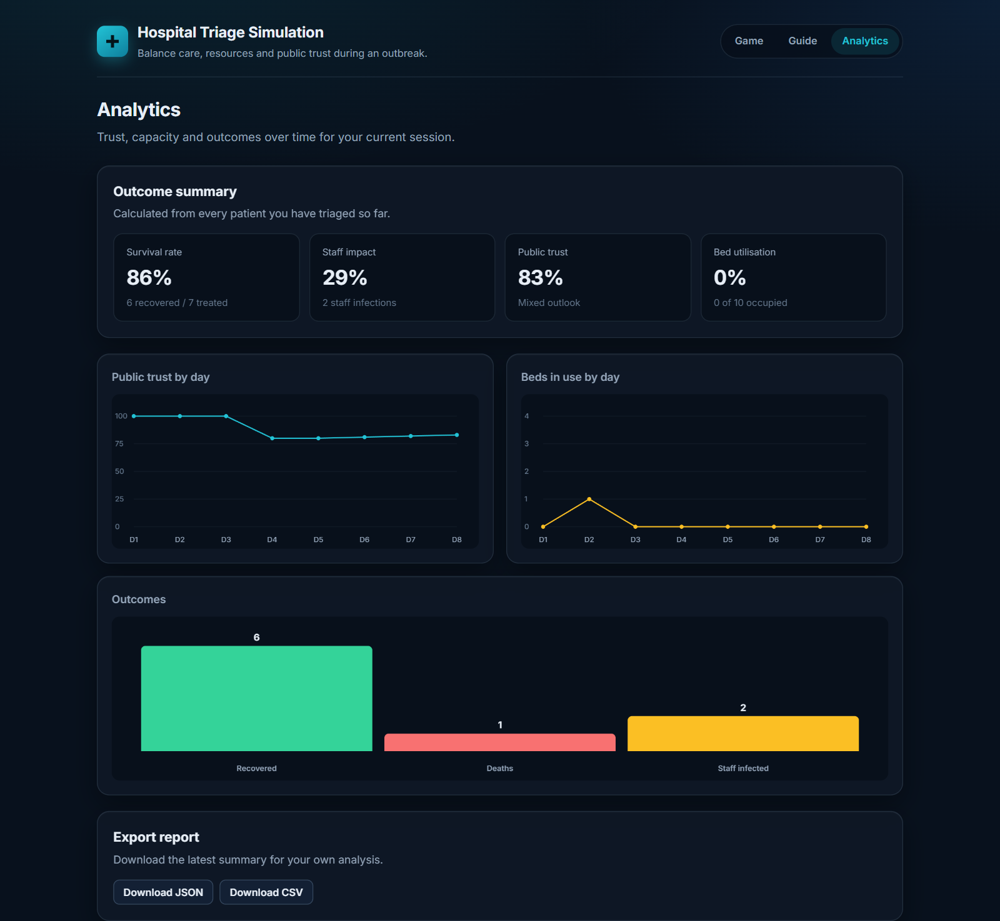

# Hospital Triage Simulation — Portfolio Overview

This repository is a compact web simulation used as a portfolio piece to demonstrate full‑stack development, data-driven UI, and design decisions. It models hospital triage decision-making and is intentionally small so it can be run locally or deployed as a demo.

**Project goal:** showcase how languages, libraries, and data are combined to build an interactive, teachable simulation.

**Live preview:** https://hospital-triage-simulation.onrender.com/ 



Why this project
----------------
- Demonstrates clean backend design with Python and Flask.
- Shows session and in-memory state management for multi-step simulations.
- Integrates a responsive front-end (HTML/CSS/JS) with optional local avatars.
- Balances deterministic logic and teachable randomness for educational value.

## Features
- Patient cards with age, symptoms, exposure, comorbidity and a risk badge (Low / Medium / High).
- Three actions per patient: Admit, Discharge, Isolate.
- Hidden deterministic risk scoring (age, fever, breathlessness, exposure, comorbidity).
- Live dashboard: day counter, available beds, patients treated, deaths, recovered, infected staff, public trust.
- Restart game and Export final report (JSON / CSV via `/export?format=...`; `xlsx` returns a CSV that Excel opens).
-  Game length shortened to 15 days (quicker runs and faster feedback loops).
- Clinical dashboard design: dark navy surfaces, a cyan accent, and green / amber / red risk colours, over a softly tinted hospital ward background.
- Mobile responsiveness fully implemented (desktop grid → tablet 2-col → mobile stacked layout).
- Guide page centered and card grid constrained for consistent layouts on all screens.
- Restart flow fixed so the final-report overlay closes cleanly and a fresh session starts on restart.
- Clear action hierarchy: Admit (primary), Isolate (amber, protective) and Discharge (neutral), with icons, press feedback and keyboard focus rings.
- Avatar system improved: attempts to use local avatar buckets first, then falls back to high-quality cartoon avatars (uifaces style) or an inline SVG placeholder, with a loading shimmer while the image arrives.
- Final report shown as a dialog with a summary grid; it fades and scales in once (200-240 ms), and all motion is switched off for users who prefer reduced motion.

## Languages & Tools
- **Python 3 + Flask:** backend routes, session/state management, deterministic scoring logic, and JSON export endpoints.
- **HTML / CSS:** semantic templates, responsive layout, and visual affordances for actions and overlays.
- **JavaScript (vanilla):** client-side interactivity, fetch-based API calls to the backend, and lightweight analytics (see `static/analytics.js`).
- **Static assets:** images and avatars stored under `static/avatars/*`, other UI assets in `static/`.

## Techniques & Concepts Demonstrated
- **Deterministic scoring model:** risk calculation combining age, symptoms, exposure, and comorbidity to produce consistent teachable outcomes.
- **Stateful sessions:** short-lived session state to drive multi-day gameplay without a database (suitable for demos and teaching).
- **Separation of concerns:** Flask handles routing and game logic; templates render UI; static JS handles user actions and analytics.
- **Responsive design & accessibility:** layout adapts across desktop/tablet/mobile and uses clear action labels and badges.
- **Client-side analytics:** lightweight event collection to help analyze user decisions (`static/analytics.js`).
- **Export & interoperability:** final reports can be exported as JSON/CSV for analysis or inclusion in datasets.

## Data & Assets (how they're used)
- **Patient data (generated):** synthetic patient objects are generated per session with deterministic randomness. These objects drive the UI and scoring.
- **Avatars & images:** stored in `static/avatars/{child,youth,adult,senior}` and selected client-side by age bucket; fallbacks exist to keep the demo robust.
- **Analytics events:** anonymized client-side events record decisions and timestamps (no PII). Event logs can be exported for analysis.

## Quick start (Windows)
1. Create and activate a virtual environment:

```powershell
python -m venv venv
venv\Scripts\activate
```

2. Install dependencies:

```powershell
pip install -r requirements.txt
```

3. Run the app locally:

```powershell
python app.py
```

4. Open http://127.0.0.1:5000

## How to play (short)
1. Review the patient card (age, symptoms, exposure, comorbidity, risk badge).
2. Choose one action: `Admit`, `Discharge`, or `Isolate`.
3. The server evaluates your choice and advances the day. The dashboard updates accordingly.
4. Game ends when: beds reach zero, public trust reaches 0, or day 15 is completed.

## UI / UX notes
- **Design system:** one stylesheet (`static/style.css`) with colour, radius and easing tokens shared by all three pages; Inter for type, tabular numbers for stats.
- **Motion with a purpose only:** no constant floating or pulsing. A new patient fades in (240 ms), progress bars animate with `transform` instead of `width`, buttons scale to 0.97 when pressed, and `prefers-reduced-motion` turns animation off.
- **Feedback:** decision buttons are disabled while a decision is processed (no double submits), and the outcome message stays visible until the next decision.
- The patient avatar area supports local avatar buckets under `static/avatars/*`. If none are found, the UI will use the online cartoon avatar fallback or an inline SVG placeholder.

| Guide | Analytics |
|---|---|
|  |  |
- Restart is implemented as a page reload to ensure a clean session reset.

## API (useful for demos)
- `GET /` — UI
- `GET /guide` — gameplay guide
- `GET /new_patient` — returns `{ patient, state }`
- `POST /decision` — JSON `{ action: 'Admit'|'Discharge'|'Isolate' }`
- `GET /export?format=json|csv` — export session summary

## Local avatars
Place images (png/jpg/webp) in the following folders to use local avatars:

- `static/avatars/child/` (ages 1–15)
- `static/avatars/youth/` (ages 16–40)
- `static/avatars/adult/` (ages 41–60)
- `static/avatars/senior/` (ages 61+)

If no files are present, the app will fetch a fallback cartoon avatar or render an inline SVG placeholder.

---
## License & Contact
Copyright © 2026 Sameeha. All rights reserved.

This repository is provided as a portfolio/demo project. If you'd like to publish it publicly under a different license or need permission details, contact: sameeharaza07@gmail.com
